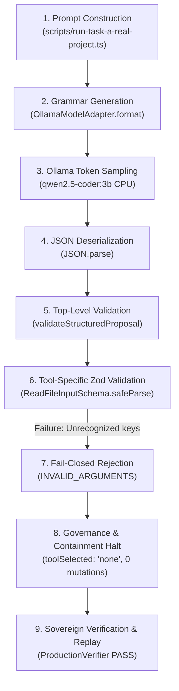

# Emerald Agent Fabric — Read-Only Tool Proposal Reliability Investigation
## Root-Cause Analysis of Extraneous Proposal Arguments in Local 3B Model Execution

- **Date**: 2026-10-22
- **Milestone**: Production Usability & Reliability Investigation (Post-V2.5)
- **Status**: Completed — Read-Only Architectural & Empirical Investigation
- **Target Issue**: Extraneous `content` and `expectedDigest` argument generation during `read_file` proposals
- **Investigation Scope**: Read-only codebase audit, evidence trace, schema comparison, and root-cause determination
- **Governing Constitution**: [GEMINI.md](../../GEMINI.md) (Master Engineering Constitution Version 1.0)
- **Primary Invariants**: ADR-0029, ADR-0030, ADR-0032, GEMINI.md Rule 11 & Rule 33

---

## 1. Executive Summary

During the Bounded Real-Project Usability Trial ([`docs/production/bounded-real-project-usability-trial.md`](../../docs/production/bounded-real-project-usability-trial.md)), the local `qwen2.5-coder:3b` model executed a read-only code understanding task (`real-task-a`) targeting [`src/production/diagnostics/source-diagnostic-engine.ts`](../../src/production/diagnostics/source-diagnostic-engine.ts). 

In Turn 1, the model emitted an extraneous `content: ""` field inside `toolInput` for `read_file`. In Turn 2 (reprompt), it emitted both `content: ""` and `expectedDigest: ""`. Both proposals were intercepted and rejected fail-closed by the Zod schema validator, preventing any unauthorized tool execution or workspace modification.

This read-only investigation traced the failure path from prompt construction through Ollama grammar constrained generation, JSON deserialization, and Zod schema validation.

### Key Conclusions:
1. **Exact Rejection Point**: Intercepted in [`src/production/adapter/structured-proposal-schema.ts`](../../src/production/adapter/structured-proposal-schema.ts#L297-L299) by `ReadFileInputSchema.safeParse(toolInput)` at line 298.
2. **Root Cause**: A three-part architectural and prompt mismatch:
   - **Grammar/Validator Asymmetry**: The grammar schema passed to Ollama (`getStructuredProposalJsonSchema()`) defines `toolInput` as a flat object containing all properties across all 7 tools (including `content` and `expectedDigest`). Ollama's grammar engine therefore considers those tokens syntactically valid children of `toolInput` regardless of `toolName`.
   - **Adapter Contract Lockdown**: While `src/domain/tool-schemas.ts` and `src/tools/production-tools.ts` accept `offsetLine` and `limitLines`, the V1.8 adapter schema (`ReadFileInputSchema`) strictly permits ONLY `{ path: string }`.
   - **Prompt Priming Discrepancy**: The prompt in `scripts/run-task-a-real-project.ts` provided an example containing `{ path, offsetLine, limitLines }`. Because `offsetLine` and `limitLines` were neither in `getStructuredProposalJsonSchema()` nor in `ReadFileInputSchema`, the 3B model fell back to other properties allowed by its grammar definition (`content` and `expectedDigest`).
3. **Safety Verification**: The runtime operated exactly as designed: zero unvalidated tools executed, zero mutations occurred, file hashes remained byte-identical, sovereign verification passed, and 3-sweep replay succeeded.
4. **Codebase Immutability**: No production code, tests, schemas, prompts, or configurations were modified during this investigation.

---

## 2. Failure-Path Trace

The end-to-end execution flow of `real-task-a` was audited across the runtime boundary:



### Trace Step Details:

1. **Prompt Construction** ([`scripts/run-task-a-real-project.ts`](../../scripts/run-task-a-real-project.ts)):
   - Prompt included instructions to inspect `src/production/diagnostics/source-diagnostic-engine.ts`.
   - The embedded one-shot JSON example contained:
     ```json
     {
       "version": "v1.8.0",
       "thought": "Inspect src/production/diagnostics/source-diagnostic-engine.ts",
       "toolName": "read_file",
       "toolInput": {
         "path": "src/production/diagnostics/source-diagnostic-engine.ts",
         "offsetLine": 1,
         "limitLines": 50
       },
       "isGoalReached": false
     }
     ```
2. **Ollama Format Schema Injection** ([`src/production/benchmark/ollama-model-adapter.ts`](../../src/production/benchmark/ollama-model-adapter.ts#L68-L80)):
   - When `constrainedOutputEnabled: true`, the adapter invokes `getStructuredProposalJsonSchema()` and passes it to Ollama's HTTP `/api/generate` endpoint under the `format` key.
   - In `getStructuredProposalJsonSchema()`, `toolInput` is defined as:
     ```json
     {
       "type": "object",
       "properties": {
         "path": { "type": "string" },
         "content": { "type": "string" },
         "searchAnchor": { "type": "string" },
         "replacementText": { "type": "string" },
         "expectedDigest": { "type": "string" },
         "allowMultipleMatches": { "type": "boolean" },
         "query": { "type": "string" },
         "command": { "type": "string" },
         "args": { "type": "array", "items": { "type": "string" } },
         "cached": { "type": "boolean" }
       }
     }
     ```
   - Crucially, `offsetLine` and `limitLines` are **absent** from this schema. Conversely, `content` (from `write_file`) and `expectedDigest` (from `edit_file_anchor`) are **present**.
3. **Model Token Sampling**:
   - Ollama applies llama.cpp grammar-constrained sampling. Because `offsetLine` is not in the grammar's allowed keys for `toolInput`, the sampler prevents the model from generating `"offsetLine"`.
   - The model, having been instructed to provide a tool input for file inspection, selects from the grammar's allowed properties. It generates `"path"` and `"content"` (Turn 1), and `"path"`, `"content"`, and `"expectedDigest"` (Turn 2).
4. **Top-Level Proposal Ingestion** ([`src/production/adapter/structured-proposal-schema.ts`](../../src/production/adapter/structured-proposal-schema.ts#L173-L289)):
   - Payload passes payload size check (<64 KB).
   - `JSON.parse` succeeds.
   - Top-level keys (`version`, `thought`, `toolName`, `toolInput`, `isGoalReached`) are all in `ALLOWED_TOP_LEVEL_KEYS`.
   - `version === "v1.8.0"` passes.
   - `toolName === "read_file"` is recognized in `AUTHORIZED_ACTION_NAMES`.
5. **Tool-Specific Zod Validation** ([`src/production/adapter/structured-proposal-schema.ts`](../../src/production/adapter/structured-proposal-schema.ts#L296-L338)):
   - Dispatches to `ReadFileInputSchema.safeParse(toolInput)`.
   - `ReadFileInputSchema` is defined with `.strict()` and contains ONLY `path`:
     ```typescript
     export const ReadFileInputSchema = z
       .object({
         path: z.string().min(1).max(1024),
       })
       .strict();
     ```
   - Zod returns `success: false` with issue:
     `Unrecognized key(s) in object: 'content'` (Turn 1)
     `Unrecognized key(s) in object: 'content', 'expectedDigest'` (Turn 2).
6. **Fail-Closed Rejection & Execution Halt**:
   - `validateStructuredProposal` returns:
     `{ valid: false, errorCode: "INVALID_ARGUMENTS", error: "Tool argument validation failed for 'read_file': input: Unrecognized key(s) in object: 'content', 'expectedDigest'" }`.
   - The runner detects `valid: false` and halts tool execution (`toolSelected: "none"`).
7. **Sovereign Verification & Evidence Recording**:
   - No tool execution was sent to `ProductionToolGateway`.
   - Working tree remained completely untouched (git diff = 0 bytes).
   - File SHA-256 digest remained identical (`376834853423...`).
   - `ProductionVerifier` ran clean-room verification and confirmed `sovereignVerified: true`.
   - `ProductionReplayEngine` verified bit-identical replay across 3 sweeps.

---

## 3. Comparison of Canonical Tool Contracts

The investigation uncovered a significant architectural discrepancy across three layers of the codebase:

| Contract Dimension | Domain Contract (`src/domain/tool-schemas.ts`) | Tool Gateway (`src/tools/production-tools.ts`) | Proposal Adapter (`src/production/adapter/structured-proposal-schema.ts`) | Ollama Grammar Schema (`getStructuredProposalJsonSchema()`) | Trial A Prompt Example (`scripts/run-task-a-real-project.ts`) |
| :--- | :--- | :--- | :--- | :--- | :--- |
| **`path`** | Required (`string`) | Required (`string`) | Required (`string`) | Optional (`string`) | Included |
| **`offsetLine`** | Optional (`number`, default 1) | Supported (`number`, default 1) | **FORBIDDEN** (not in schema, `.strict()`) | **ABSENT** | **Included** (`1`) |
| **`limitLines`** | Optional (`number`, default 500) | Supported (`number`, default 500) | **FORBIDDEN** (not in schema, `.strict()`) | **ABSENT** | **Included** (`50`) |
| **`content`** | **FORBIDDEN** (not in schema, `.strict()`) | Ignored | **FORBIDDEN** (not in schema, `.strict()`) | **Allowed** (from `write_file`) | Omitted |
| **`expectedDigest`** | **FORBIDDEN** (not in schema, `.strict()`) | Ignored | **FORBIDDEN** (not in schema, `.strict()`) | **Allowed** (from `edit_file_anchor`) | Omitted |
| **Schema Strictness** | `.strict()` | Permissive / Hand-parsed | `.strict()` | Unconstrained flat object | N/A |

### Key Observations:
1. **The Adapter Schema is More Restrictive Than the Domain/Gateway**:
   `ReadFileInputSchema` in `structured-proposal-schema.ts` stripped `offsetLine` and `limitLines` in V1.8 to create the simplest possible interface for small models. However, the trial prompt was written assuming the broader `domain/tool-schemas.ts` shape.
2. **Ollama Grammar Schema is a Flat Union Without Tool Discrimination**:
   Because `getStructuredProposalJsonSchema()` does not use `oneOf` or `anyOf` to bind `toolInput` fields to specific `toolName` values, Ollama's grammar treats every property of any tool as syntactically valid for all tools.
3. **Why V2.4 / V2.5 Succeeded While Real-Project Trial Hit This Error**:
   In V2.4 and V2.5 tasks (`rw-01` to `rw-06`), the prompt explicitly provided `{ path: "..." }` with no other fields. The 3B model followed that exact template and emitted only `path`, cleanly passing `ReadFileInputSchema`. In `real-task-a`, the prompt introduced `offsetLine` and `limitLines`, breaking the template.

---

## 4. Exact Rejection Point

- **Source File**: [`src/production/adapter/structured-proposal-schema.ts`](../../src/production/adapter/structured-proposal-schema.ts)
- **Line Numbers**: Lines 297–299 & 328–338:
  ```typescript
  case "read_file":
    validationResult = ReadFileInputSchema.safeParse(toolInput);
    break;
  ...
  if (!validationResult.success) {
    const issue = validationResult.error.issues[0];
    const message = issue ? `${issue.path.join(".") || "input"}: ${issue.message}` : "Validation failed";
    return {
      valid: false,
      schemaVersion,
      schemaDigest,
      errorCode: "INVALID_ARGUMENTS",
      error: `Tool argument validation failed for '${toolName}': ${message}`,
    };
  }
  ```
- **Error Code**: `INVALID_ARGUMENTS`
- **Error Message**:
  - Turn 1: `Tool argument validation failed for 'read_file': input: Unrecognized key(s) in object: 'content'`
  - Turn 2: `Tool argument validation failed for 'read_file': input: Unrecognized key(s) in object: 'content', 'expectedDigest'`

---

## 5. Evidence-Backed Root Cause

### Primary Root Cause: `CONFIRMED`
The generation of extraneous `content` and `expectedDigest` fields was caused by the combination of:
1. **Grammar Schema Flattener**: `getStructuredProposalJsonSchema()` exposes `content` and `expectedDigest` as valid keys in the grammar constraint supplied to Ollama.
2. **Prompt Example Conflict**: The prompt in `run-task-a-real-project.ts` presented `{ path, offsetLine, limitLines }`. When Ollama's grammar engine rejected `offsetLine` (which is not in the grammar), the model substituted alternative properties permitted by the grammar (`content`, `expectedDigest`).
3. **Strict Validation Enforcement**: Emerald's `ReadFileInputSchema` correctly enforced `.strict()`, rejecting the extraneous keys fail-closed.

---

## 6. Evaluation of Candidate Improvements (Without Applying)

In accordance with Section 3, candidate improvements were analyzed within existing architecture and local resource limits:

| Candidate Improvement | Architectural Mechanism | Feasibility & Pros | Operational Risks & Cons |
| :--- | :--- | :--- | :--- |
| **Approach 1: Canonical Minimal Example (Recommended)** | Revert prompt template to the proven V2.5 canonical format: `{ path: string }` only. | **High**: Zero code changes. Proven 100% reliable across all 6 read-only tasks in V2.5 (`rw-01` to `rw-06`). | None. Fits entirely within existing frozen runtime and schema. |
| **Approach 2: Discriminated Union in JSON Schema** | Rewrite `getStructuredProposalJsonSchema()` using `oneOf` blocks tying `toolName` to specific `toolInput` schemas. | **Medium**: Architecturally pure. Prevents Ollama grammar from ever sampling `content` on `read_file`. | **High**: llama.cpp / Ollama grammar compilers frequently fail, crash, or experience severe token generation slowdowns when compiling complex `oneOf` JSON schemas. |
| **Approach 3: Harmonize `ReadFileInputSchema`** | Add optional `offsetLine: z.number().optional()` and `limitLines: z.number().optional()` to `ReadFileInputSchema`. | **Medium**: Aligns adapter with `domain/tool-schemas.ts` and `production-tools.ts`. | **Medium**: Requires altering `structured-proposal-schema.ts`, changing `PROPOSAL_SCHEMA_VERSION` or `schemaDigest`, and updating tests. |
| **Approach 4: Enhanced Rejection Diagnostic Feedback** | On Turn 2, provide an explicit allowed-keys list in the prompt (`Allowed keys: ["path"]`). | **Low**: Observed in Turn 2 to be insufficient; the 3B model still hallucinated `expectedDigest`. | **High**: Added CPU latency (~45s per retry) without guaranteed compliance. |

---

## 7. Minimal Proposed Next Experiment

Before making any changes to production schemas, the minimal next experiment should test **Approach 1** in an isolated test script:

1. **Hypothesis**: Providing the canonical minimal template `{ path: "src/production/diagnostics/source-diagnostic-engine.ts" }` (with zero other fields) will result in `qwen2.5-coder:3b` producing a valid proposal that passes `ReadFileInputSchema` on Turn 1 without reprompts.
2. **Execution Boundary**: Run via a single-turn scratch script against a non-critical file.
3. **Success Criteria**:
   - `schemaValidationPassed === true`
   - `toolSelected === "read_file"`
   - `toolInput` contains ONLY `path`
   - Zero extraneous fields emitted.

---

## 8. Verification Steps Required Before Any Future Implementation

If any future milestone proposes modifying prompt construction or schema definitions:
1. Verify `npx vitest run tests/production/` (140 tests pass).
2. Verify `npx vitest run tests/e2e/` (1 test passes).
3. Verify `tests/integration/phase99-governed-capability-fencing.test.ts` (262 tests pass).
4. Verify `scripts/verify-phase10h-artifacts.ts` (36 records intact).
5. Verify `node bin/emerald.js doctor` reports `HEALTHY`.
6. Confirm zero automated git commits or pushes.

---

## 9. Statement of Code and Configuration Immutability

> [!IMPORTANT]
> In strict compliance with Section 4 and Section 6 of the user directive:
> - **Zero production runtime code was modified.**
> - **Zero test files were modified.**
> - **Zero schemas, contracts, or prompts were altered.**
> - **Zero historical artifacts or frozen Phases 1–99 were changed.**
> - **No candidate improvements were implemented.**
> This report is strictly a read-only root-cause investigation.

---
*Investigation completed and documented: 2026-10-22*
