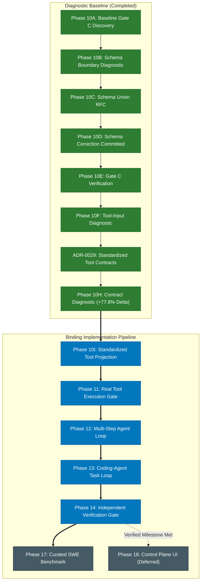

# Emerald Agent Fabric: Sequenced Build Order and Conformance Gates

**Document ID**: `EAF-OSS-006`  
**Date of Ratification**: 2026-10-16  
**Status**: BINDING MASTER ENGINEERING ROADMAP  
**Author**: Senior AI Infrastructure Engineer & Technical Co-Founder  
**Approved Baseline**: ADR-0029, EAF-OSS-001 through EAF-OSS-005  

---

## 1. Executive Summary and Architecture Invariants

This document establishes the binding implementation sequence and explicit conformance gates for advancing Emerald Agent Fabric from diagnostic boundary validation to verified autonomous software engineering execution.

In strict adherence to the Master Engineering Constitution ([`GEMINI.md`](file:///c:/Users/Adusumalli%20Girish/.gemini/antigravity/scratch/emerald-agent-fabric/GEMINI.md)), the development sequence follows:
$$\text{SPECIFY} \rightarrow \text{DESIGN} \rightarrow \text{IMPLEMENT} \rightarrow \text{VERIFY} \rightarrow \text{MEASURE} \rightarrow \text{DOCUMENT}$$

### Absolute Frozen Core Constraints
The following architectural foundations are frozen. They must not be redesigned, refactored, bypassed, or replaced:
1. **Runtime State Machine**: Explicit lifecycle states (`CREATED` $\rightarrow$ `QUEUED` $\rightarrow$ `LEASED` $\rightarrow$ `RUNNING` $\rightarrow$ `VERIFYING` $\rightarrow$ `COMPLETED` / `FAILED` / `RECOVERING`).
2. **SQLite Persistence**: WAL-mode ACID transactions with monotonic sequence IDs and lease fencing.
3. **Worker Leases & Fencing**: Token-based fencing on all state transitions preventing split-brain mutations.
4. **Governed Execution Gateway**: `ProposalValidator` $\rightarrow$ `Reflex` $\rightarrow$ `PolicyEvaluator` $\rightarrow$ `ToolExecutionGateway`.
5. **Action/Attempt Separation**: Logical intention (`Action`) strictly separated from physical trials (`Attempt`).
6. **Hardened Sandbox Confinement**: Docker runtime with `no-new-privileges`, non-root execution, read-only root filesystems, and bounded workspace mounts.

---

## 2. Master Implementation Dependency Graph



---

## 3. Mandatory Implementation Sequence and Conformance Gates

Every phase must satisfy its explicit **Entry Criteria**, produce its **Required Implementation**, pass its **Automated Conformance Gate**, and generate its **Evidence Artifacts** before the next phase may begin. No phase may be marked complete based on code existing without empirical evidence.

---

### Phase 10I: Standardized Tool Projection

- **Status**: **READY TO IMPLEMENT (Single Next Implementation Step)**.
- **Pre-requisite**: Phase 10H empirical validation (77.8% valid tool-input rate, zero argument hallucinations).
- **Objective**: Implement ADR-0029's decided architecture: generate compact, deterministic, model-facing prompt representations directly projected from authoritative typed schemas in `tool-schemas.ts` and `tool.ts`.
- **Scope Boundary**:
  - Implement `formatModelFacingToolContracts()` projection helper.
  - Wire projection into `LiveAgentBrain` prompt construction.
  - Zero changes to domain schemas, validators, governance policies, Reflex thresholds, or execution adapters.
- **Conformance Gate**:
  1. `npm run typecheck` passes with zero errors.
  2. `npm test` passes with 100% existing tests intact.
  3. `tests/application/live-agent-brain-tool-projection.test.ts` proves that all six tool descriptions are deterministically projected from `tool-schemas.ts` with zero schema drift.
  4. Prompt overhead per tool is bounded ($\le 250$ bytes per tool definition).
- **Required Evidence Artifacts**:
  - `docs/adr/ADR-0029-rfc-standardized-model-facing-tool-contracts.md` updated with implementation commit SHA.
  - Unit test run log confirming 100% projection conformance.

---

### Phase 11: Real Tool Execution Gate

- **Status**: PENDING (Blocked on Phase 10I).
- **Pre-requisite**: Phase 10I completed and verified.
- **Objective**: Cross the physical execution boundary. Achieve the first live, governed physical tool execution on a real SWE task under `WorkerRuntime`.
- **Required Implementation**:
  - Single-step live execution harness.
  - Connect `LiveAgentBrain` proposal to `AgentStepController` $\rightarrow$ `ProposalValidator` $\rightarrow$ `Reflex` $\rightarrow$ `PolicyEvaluator` $\rightarrow$ `ToolExecutionGateway`.
- **Conformance Gate (Binary Pass/Fail)**:
  1. At least one controlled model proposal (`llama3.2:3b` on CPU) passes validation, policy checks, and gateway authorization.
  2. Physical tool execution executes inside the provisioned workspace or container.
  3. Exactly 1 `Action` (`status = COMPLETED`) and 1 `Attempt` (`status = SUCCESS`) are committed to SQLite with matching lease tokens.
  4. Real tool observation (e.g. file content from `read_file` or search result from `search_code`) is captured and durably recorded in `execution_evidence`.
  5. Zero physical execution bypasses `ToolExecutionGateway`.
- **Required Evidence Artifacts**:
  - SQLite database dump showing linked `runs`, `actions`, `attempts`, and `domain_events`.
  - Serialized `evidence-phase11-execution.json` containing complete execution record.

---

### Phase 12: Multi-Step Agent Loop

- **Status**: PENDING (Blocked on Phase 11).
- **Pre-requisite**: Phase 11 real tool execution demonstrated.
- **Objective**: Advance from a single isolated step to a multi-step feedback loop where tool observations are injected into the subsequent model context.
- **Required Implementation**:
  - Step iteration logic in `AgentStepController` ($1 \le \text{step} \le \text{maxSteps}$).
  - `ContextEngine` observation ingestion feeding previous tool output into prompt context.
  - Bounded requery loop on `INVALID_TOOL_INPUT` ($\le 2$ requeries per step).
  - Observation truncation ($\le 16\text{ KB}$ with explicit omission markers).
  - Clean termination upon `isGoalReached === true` or step budget exhaustion.
- **Conformance Gate**:
  1. Step 1 tool observation (e.g. file path from `search_code`) is present in Step 2 model context.
  2. Model successfully uses observation data to formulate Step 2 proposal (e.g. `read_file` on discovered path).
  3. Bounded requery recovers from malformed proposals without mutating environment state.
  4. Loop terminates cleanly with run transitioning to `VERIFYING` or `COMPLETED`.
  5. Step transcript and trajectory JSON are durably recorded in SQLite.
- **Required Evidence Artifacts**:
  - `phase12-multi-step-trajectory.json` recording multi-step execution trace.
  - Latency breakdown table decomposing each step's inference, execution, and persistence timings.

---

### Phase 13: Coding-Agent Task Loop

- **Status**: PENDING (Blocked on Phase 12).
- **Pre-requisite**: Phase 12 multi-step loop verified.
- **Objective**: Complete a real code-editing and test-feedback cycle across Emerald's six frozen tools (`read_file`, `search_code`, `git_status`, `git_diff`, `write_file`, `run_command`).
- **Required Implementation**:
  - Automated test-feedback reflection: `run_command` test failure output injected directly into next step context.
  - Bounded reflection counter ($\le 3$ repair attempts per task).
  - Diff inspection step via `git_diff` following `write_file`.
- **Conformance Gate**:
  1. Model inspects a codebase with an intentional defect, edits code via `write_file`, verifies edit via `git_diff`, and runs test via `run_command`.
  2. When test fails, error stack trace is presented in next prompt.
  3. Model repairs the defect on subsequent attempt.
  4. Tests pass with exit code 0.
  5. All modifications remain strictly confined within `MissionContract.executionPolicy.allowedPaths`.
- **Required Evidence Artifacts**:
  - Candidate patch unified diff.
  - Full execution trajectory showing test failure $\rightarrow$ repair $\rightarrow$ test pass.

---

### Phase 14: Independent Verification Gate

- **Status**: PENDING (Blocked on Phase 13).
- **Pre-requisite**: Phase 13 coding-agent loop demonstrated.
- **Objective**: Implement clean-room independent verification. Enforce that an agent's claim of completion is never authoritative.
- **Required Implementation**:
  - `VerificationOrchestrator` provisioning clean sandbox from base commit.
  - Candidate patch application via `git apply`.
  - Automated test runner executing `FAIL_TO_PASS` and `PASS_TO_PASS` test suites.
  - Anti-false-positive `SUITE_RAN` regex verification ($> 0$ tests executed).
  - Post-hoc `TIER_ENVIRONMENT` vs `TIER_AMBIGUOUS` classification.
  - Fourfold rule enforcement:
    $$\text{TaskSatisfied} \land \text{VerificationPassed} \land \text{PolicySatisfied} \land \text{EvidenceComplete}$$
- **Conformance Gate**:
  1. Clean candidate patch is applied to a pristine environment (not the agent's workspace).
  2. $\text{F2P} = 1.0$ (100% targeted bug tests pass).
  3. $\text{P2P} = 1.0$ (100% regression tests pass).
  4. Zero-test execution (empty suite) is rejected as `TEST_SUITE_NEVER_RAN`.
  5. Run transitions to `COMPLETED` if and only if all four conditions are satisfied; otherwise `FAILED`.
- **Required Evidence Artifacts**:
  - `verification-report.json` with cryptographic bundle hash and test status map.
  - Verification execution log from clean-room container.

---

### Phase 17: Curated SWE Benchmark

- **Status**: DEFERRED (Blocked on Phase 14).
- **Pre-requisite**: Phase 14 independent verification operational end-to-end.
- **Objective**: Execute the 12-task curated benchmark starter mix, classify failures using the 12-category taxonomy, and execute single-variable improvements.
- **Conformance Gate**:
  1. 12 tasks $\times$ 3 trials (36 runs total) executed under automated test harness.
  2. 100% of failed runs deterministically classified into the 12-category taxonomy.
  3. Zero unverified runs marked as resolved.
  4. Full failure distribution and latency profile published.

---

### Phase 18: Control Plane UI

- **Status**: STRICTLY DEFERRED (Blocked on Phase 14 & 17).
- **Pre-requisite**: End-to-end verified patch generation proven in Phase 14.
- **Rationale for Deferral**: Building a frontend before the underlying execution loop, state transitions, and verification engine are proven creates UI-driven architectural churn, speculative data models, and ungrounded engineering effort.
- **Conformance Gate**:
  1. Read-only Fastify API projecting SQLite `runs`, `actions`, `attempts`, and `execution_evidence`.
  2. Real-time SSE stream adhering to decoupled frame protocol (`SyncFrame`, `DurableFrame`).
  3. Zero dual-write state stores.

---

## 4. Verification and Certification Commands

Before closing any phase or transitioning to the next, the following suite must be executed with 100% pass:

```powershell
# 1. Typecheck entire TypeScript workspace
npx tsc --noEmit

# 2. Run full Vitest unit and integration test suite
npm test

# 3. Verify git tree hygiene (no unintended modifications or secrets)
git diff --check
git status
```

---

## 5. Architectural Non-Regression Invariants

Throughout all implementation phases:
1. Model output is **never** automatically authoritative.
2. `ProposalValidator` must never be bypassed.
3. Reflex decisions must remain observable.
4. Policy authorization must never be delegated to prompt instructions.
5. All physical tool execution must pass through `ToolExecutionGateway`.
6. SQLite transactions and lease fencing must guard all state updates.
7. Verification must always execute in a clean-room sandbox.
8. Evidence bundles must remain cryptographically verifiable.
