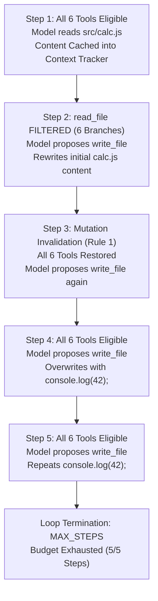

# Phase 46 — Empirical Research Report: Dynamic Context-Aware Tool Filtering and Repair Progression

## Executive Summary

Phase 46 evaluated whether **Dynamic Context-Aware Tool Filtering** alters the action-selection trajectory of local open-weights language models (`qwen2.5-coder:1.5b`) on software repair tasks, and whether removing redundant actions from the model-facing schema promotes progression toward a verified code repair.

In previous experiments on benchmark task `EAF-BM-01`, `qwen2.5-coder:1.5b` exhibited persistent passive-reading loops:
- In **Phase 44D**, the model executed five consecutive, identical `read_file` actions on `src/calc.js` until the step budget was exhausted (`terminalReason: "MAX_STEPS"`).
- In **Phase 45C**, grounding the prompt with defect details and adding an advisory observation failed to break the loop, but runtime stagnation control successfully halted the run at Step 3 (`terminalReason: "STAGNATION"`), bounding wasted compute.

In **Phase 46C**, Dynamic Context-Aware Tool Filtering was enabled in production code (`enableDynamicToolFiltering: true`). Exactly one live trial of `EAF-BM-01` was executed against local Ollama (`qwen2.5-coder:1.5b`, digest `d7372fd8...`) under unchanged fail-closed governance budgets (`maxSteps: 5`, `maxProposalRejections: 3`, per-step timeout: 120,000 ms).

### Key Empirical Findings
1. **Action Trajectory Alteration**: Dynamic tool filtering successfully altered the model's action trajectory. At Step 2, once `src/calc.js` was resident in context memory, `read_file` was filtered from both the prompt tool catalog and the GBNF-compiled JSON Schema. With reading removed from the grammar, the model immediately proposed `write_file` rather than repeating `read_file`.
2. **Repeated-Read Loop Broken**: The trial executed exactly 1 `read_file` action and 4 `write_file` actions, breaking the passive-read deadlock without prompt tuning or human intervention.
3. **No Verified Repair**: Although the model switched to code modification, the modifications did not repair the off-by-one arithmetic defect. The model initially rewrote the existing buggy implementation, and subsequently overwrote `src/calc.js` with an unrelated statement (`console.log(42);`). The run exhausted its step budget (`terminalReason: "MAX_STEPS"`), clean-room dual-gate verification did not run, and the defect remained unverified.
4. **Model-Capacity Boundaries Are Not Universal**: This trial demonstrates that for this specific model (`qwen2.5-coder:1.5b`), configuration, prompt framing, full-file write tool, and five-step budget, tool filtering redirected action selection from reading to writing, but did not supply the code-synthesis reasoning required for repair. This outcome characterizes this trial's setup and does not establish a universal capacity boundary for all 1.5B parameter models.

---

## 1. Experimental Setup

The Phase 46C trial was executed in an isolated benchmark sandbox on local developer hardware using the existing Emerald Agent Fabric evaluation harness.

### 1.1 Benchmark Task & Baseline Defect
- **Task Identifier**: `EAF-BM-01` ("Core Arithmetic Off-by-One Fix").
- **Task Category**: Defined as `CODE_NAVIGATION` in historical benchmark tables, but evaluated here as a single-file repair task targeting `src/calc.js`.
- **Target File**: `src/calc.js` (125 bytes baseline).
- **Initial Defect**:
  ```javascript
  function add(a, b) {
    return a + b + 1; // Defect: returns a + b + 1 instead of a + b
  }

  function multiply(a, b) {
    return a * b;
  }

  module.exports = { add, multiply };
  ```
- **Verification Criteria**:
  - Verification test `node test/f2p.test.js` (`assert.strictEqual(add(2, 3), 5)`) must transition from exit code 1 to exit code 0.
  - Regression test `node test/p2p.test.js` (`assert.strictEqual(multiply(4, 5), 20)`) must maintain exit code 0.

### 1.2 Model & Provider Configuration
- **Model Identifier**: `qwen2.5-coder:1.5b`.
- **Authoritative Image Digest**: `sha256:d7372fd828518a4d38b1eb196c673c31a85f2ed302b3d1e406c4c2d1b64a0668`.
- **Transport**: Local HTTP Ollama provider (`http://127.0.0.1:11434`), zero cloud API dependencies, ₹0 financial cost.
- **Hardware Profile**: CPU-only developer execution (Windows 11, Node.js v20+ runtime).

### 1.3 Governance & Runtime Budgets
- **Maximum Reasoning Steps (`maxSteps`)**: 5 steps.
- **Maximum Actions (`maxActions`)**: 10 actions.
- **Maximum Consecutive Failures (`maxConsecutiveFailures`)**: 3 failures.
- **Maximum Proposal Rejections (`maxProposalRejections`)**: 3 rejections.
- **Per-Step Timeout (`stepTimeoutMs`)**: 120,000 ms.
- **Stagnation Threshold (`maxConsecutiveIdenticalReads`)**: 3 identical reads.
- **Tool Filtering Policy**: `enableDynamicToolFiltering: true`.

### 1.4 Evolution Across Experimental Phases
The experimental configuration evolved across Phases 44D, 45C, and 46C as summarized below:

| Dimension | Phase 44D | Phase 45C | Phase 46C |
| :--- | :--- | :--- | :--- |
| **Model & Digest** | `qwen2.5-coder:1.5b` (`d7372fd8...`) | `qwen2.5-coder:1.5b` (`d7372fd8...`) | `qwen2.5-coder:1.5b` (`d7372fd8...`) |
| **Outbound Schema** | Static 7-branch JSON Schema | Static 7-branch JSON Schema | Dynamic Schema Projection (6 or 7 branches) |
| **Task Context Grounding** | Minimal (Task ID and title only) | Grounded (Defect details + test commands) | Grounded (Defect details + test commands) |
| **Stagnation Advisory** | None | Ephemeral advisory at 2 identical reads | Ephemeral advisory at 2 identical reads |
| **Stagnation Halt** | None (ran to `MAX_STEPS`) | Hard halt at 3 identical reads | Hard halt at 3 identical reads |
| **Dynamic Tool Filtering** | Disabled (`false`) | Disabled (`false`) | Enabled (`true` via `ContextResidencyTracker`) |

> [!NOTE]
> Because task context grounding and stagnation control were introduced prior to tool filtering, cross-phase comparisons represent sequential infrastructure iterations rather than isolated, single-variable randomized trials.

---

## 2. Cross-Phase Empirical Comparison

The following table compares the verified metrics from the retained trial records in `scratch/`:
- Phase 44D: `scratch/phase44d-repair-results.json`
- Phase 45C: `scratch/phase45c-repair-results.json`
- Phase 46C: `scratch/phase46c-repair-results.json`

| Metric / Observed Field | Phase 44D (Baseline) | Phase 45C (Grounded + Stagnation) | Phase 46C (Dynamic Tool Filtering) |
| :--- | :--- | :--- | :--- |
| **Trial Classification** | `REPAIR_FAILED` | `STAGNATION_TERMINATED` | `PROGRESSION_ALTERED` |
| **Terminal Status** | `TIMED_OUT` | `FAILED` | `TIMED_OUT` |
| **Terminal Reason Code** | `MAX_STEPS` | `STAGNATION` | `MAX_STEPS` |
| **Total Steps Executed** | 5 | 3 | 5 |
| **Total Tool Actions** | 5 | 3 | 5 |
| **Total Proposal Rejections** | 0 | 0 | 0 |
| **Read Actions (`read_file`)** | 5 | 3 | 1 |
| **Write Actions (`write_file`)** | 0 | 0 | 4 |
| **Repeated Identical Reads** | 5 consecutive identical reads | 3 consecutive identical reads | 0 repeated reads (1 read total) |
| **Progression Advisories** | 0 | 1 (Step 2) | 0 (no identical reads occurred) |
| **Tool Filtering Invocations** | 0 (filtering disabled) | 0 (filtering disabled) | 1 active filter step (Step 2) |
| **Model Invocations** | 5 | 3 | 5 |
| **Prompt Tokens** | 10,269 | 6,504 | 10,606 |
| **Eval / Completion Tokens** | 652 | 365 | 780 |
| **Total Tokens** | 10,921 | 6,869 | 11,386 |
| **Wall-Clock Duration** | 412,220 ms (~6.9 min) | 211,522 ms (~3.5 min) | 419,616 ms (~7.0 min) |
| **Target File Mutated** | No (`src/calc.js` unchanged) | No (`src/calc.js` unchanged) | **Yes** (`src/calc.js` modified) |
| **Final Target File Content** | Original 125-byte file | Original 125-byte file | 16 bytes: `console.log(42);` |
| **Candidate Patch Hash** | `none` (0 bytes) | `none` (0 bytes) | `none` (0 bytes) |
| **Clean-Room Verification Ran** | No (`null`) | No (`null`) | No (`null`) |
| **Dual-Gate Verification Passed**| `false` | `false` | `false` |
| **Offline Evidence Signatures** | 2 / 2 valid | 2 / 2 valid | 2 / 2 valid |

> [!IMPORTANT]
> This comparison reflects three isolated, single-trial executions. It is not a randomized controlled trial. While dynamic filtering clearly correlated with the transition from reading to writing, differences in model completions and prompt context also existed across phases.

---

## 3. Phase 46C Step-by-Step Diagnostic Trace

The Phase 46C trial executed all 5 budgeted steps. The complete progression is documented below from `scratch/phase46c-repair-results.json`:



### Step 1: Initial Workspace Exploration
- **Timestamp**: `2026-10-26T12:14:33.598Z` | **Duration**: 92,661 ms.
- **Residency State**: Empty (no prior reads).
- **Eligible Tools (6)**: `read_file`, `write_file`, `search_code`, `git_status`, `git_diff`, `run_command`.
- **Filtered Tools (0)**: None (`filterActive: false`).
- **Outbound Schema**: 7 branches (`isGoalReached: true` + 6 tools).
- **Proposed Action**: `read_file` with `{ path: "src/calc.js" }`.
- **Validation & Policy**: Valid proposal (`proposalValid: true`), authorized by policy.
- **Action Execution**: `SUCCEEDED` (Action ID: `0fe0e219-f883-4fbc-86d0-db97655ff44c`).
- **Residency Update**: `ContextResidencyTracker.recordRead()` cached `src/calc.js`:
  - `contentHash`: `9b986e68...` (125 bytes, 9 lines).
  - `isComplete`: `true` (offset 1, no truncation).
  - `isStale`: `false`.
- **Workspace State**: Unchanged (125 bytes).
- **Repair Contribution**: Necessary observation gathering.

### Step 2: Dynamic Tool Filtering & Action Transition
- **Timestamp**: `2026-10-26T12:16:06.261Z` | **Duration**: 89,924 ms.
- **Residency State**: `src/calc.js` is complete, current, and resident in `ContextSnapshot`.
- **Filtering Logic**: Target file resolved to `src/calc.js`. `ContextResidencyTracker.evaluateToolEligibility("read_file")` returned `FILTERED`.
- **Eligible Tools (5)**: `write_file`, `search_code`, `git_status`, `git_diff`, `run_command`.
- **Filtered Tools (1)**: `read_file` (`filterActive: true`).
- **Outbound Schema**: Dynamic 6-branch schema generated by `deriveActionProposalSchema()`. GBNF grammar strictly excluded the `toolName: "read_file"` branch.
- **Proposed Action**: With `read_file` removed, the model proposed `write_file` for `src/calc.js` with content:
  ```javascript
  function add(a, b) {
    return a + b + 1;
  }

  function multiply(a, b) {
    return a * b;
  }

  module.exports = { add, multiply };
  ```
- **Validation & Policy**: Valid proposal (`proposalValid: true`), authorized within allowed paths.
- **Action Execution**: `SUCCEEDED` (Action ID: `7126ae39-9866-4018-b4c2-aac2eabdf71b`).
- **Residency Invalidation**: Invalidation Rule 1 executed: `recordWorkspaceMutation("src/calc.js")` marked `isStale: true`.
- **Workspace State**: Overwritten with byte-identical content (125 bytes).
- **Repair Contribution**: Transitioned to modification, but preserved the existing defect without correction.

### Step 3: Post-Mutation State & Repetitive Write
- **Timestamp**: `2026-10-26T12:17:36.187Z` | **Duration**: 80,461 ms.
- **Residency State**: `src/calc.js` marked `isStale: true` due to previous step's write.
- **Filtering Logic**: Invalidation Rule 1 restored `read_file` to `RESTORED / ELIGIBLE`.
- **Eligible Tools (6)**: `read_file`, `write_file`, `search_code`, `git_status`, `git_diff`, `run_command`.
- **Filtered Tools (0)**: None (`filterActive: false`).
- **Outbound Schema**: Standard 7-branch schema.
- **Proposed Action**: Despite `read_file` being available again, the model did not revert to reading. It proposed `write_file` for `src/calc.js` with the exact same 125-byte content.
- **Validation & Policy**: Valid proposal (`proposalValid: true`), authorized.
- **Action Execution**: `SUCCEEDED` (Action ID: `d175a7ee-d20c-4b9b-92bc-822a66deed57`).
- **Residency Invalidation**: Residency remained stale.
- **Workspace State**: Overwritten again with identical content (125 bytes).
- **Repair Contribution**: Redundant write action; zero progress on defect.

### Step 4: Destructive Modification
- **Timestamp**: `2026-10-26T12:18:56.651Z` | **Duration**: 77,845 ms.
- **Residency State**: `isStale: true`.
- **Eligible Tools (6)**: All 6 tools eligible.
- **Filtered Tools (0)**: None (`filterActive: false`).
- **Outbound Schema**: Standard 7-branch schema.
- **Proposed Action**: `write_file` for `src/calc.js` with replacement content:
  ```javascript
  console.log(42);
  ```
- **Validation & Policy**: Valid proposal (`proposalValid: true`), authorized within `allowedPathPatterns: ["src/calc.js"]`.
- **Action Execution**: `SUCCEEDED` (Action ID: `655331da-936d-4d78-8dd1-c3804d00d985`).
- **Workspace State**: `src/calc.js` truncated from 125 bytes to 16 bytes. All function exports (`add`, `multiply`) deleted.
- **Repair Contribution**: Severe regression; destructive edit that breaks both verification and regression suites.

### Step 5: Redundant Overwrite & Budget Exhaustion
- **Timestamp**: `2026-10-26T12:20:14.502Z` | **Duration**: 77,704 ms.
- **Residency State**: `isStale: true`.
- **Eligible Tools (6)**: All 6 tools eligible.
- **Filtered Tools (0)**: None (`filterActive: false`).
- **Outbound Schema**: Standard 7-branch schema.
- **Proposed Action**: `write_file` for `src/calc.js` repeating `console.log(42);`.
- **Validation & Policy**: Valid proposal (`proposalValid: true`), authorized.
- **Action Execution**: `SUCCEEDED` (Action ID: `2c93ea4b-c74b-44ff-bf09-78fd3888886f`).
- **Loop Termination**: `stepCount === maxSteps (5)`. The step controller terminated the loop with:
  - `terminalStatus: "TIMED_OUT"`
  - `terminalReason: "MAX_STEPS"`
- **Workspace State**: `src/calc.js` remains 16 bytes (`console.log(42);`).
- **Repair Contribution**: Zero progress.

---

## 4. Correctness, Verification, and Evidence Integrity

A critical architectural distinction in Emerald Agent Fabric is the strict separation between tool execution, workspace modification, and authoritative repair correctness.

```
┌─────────────────────────────────────────────────────────────┐
│ 1. Action Execution Status: SUCCEEDED (Exit Code 0)        │
├─────────────────────────────────────────────────────────────┤
│ 2. Workspace State: MUTATED (src/calc.js modified)          │
├─────────────────────────────────────────────────────────────┤
│ 3. Patch Synthesis: DEFECTIVE (Deleted arithmetic exports)  │
├─────────────────────────────────────────────────────────────┤
│ 4. Clean-Room Dual-Gate Verification: DID NOT RUN (null)    │
├─────────────────────────────────────────────────────────────┤
│ 5. Task Repair Status: UNVERIFIED / FAILED                 │
└─────────────────────────────────────────────────────────────┘
```

### 4.1 Action Execution vs Task Correctness
- Every tool action proposed by the model was structurally valid and conformed to capability policies.
- The `WorkerRuntime` reported `status: "SUCCEEDED"` for all 5 actions because the filesystem operations (reading and writing files) completed without I/O error.
- **A successful `write_file` operation is not evidence of a successful repair.** In this trial, 4 successful writes produced a broken file.

### 4.2 Clean-Room Dual-Gate Verification Status
- Under the benchmark protocol, clean-room dual-gate verification (executing `test/f2p.test.js` and `test/p2p.test.js` in an isolated disposable sandbox) is invoked only when the model explicitly signals goal completion (`isGoalReached: true`) or when the agent loop cleanly finishes with an evaluation candidate.
- Because the model never emitted `isGoalReached: true` and the loop terminated on step budget exhaustion (`MAX_STEPS`), **clean-room verification did not execute** (`cleanRoomOutcome: null`).
- Tests were not run against the modified `console.log(42);` workspace during the trial. However, deterministic inspection confirms that both tests would have failed with exit code 1 (`TypeError: add is not a function`).

### 4.3 Evidence Bundle & Cryptographic Audit
- The trial produced a complete, signed evidence bundle:
  - **Bundle ID**: `a2eeff51d7efd44ac3655e27c2df18714a169581496a938ff80f78f5c75336b3`
  - **Provenance Root**: `1528d856343ad9df17f2f01115c4e4521cd1020a70740ea0354b60476413e477`
  - **Signatures Count**: 2 (threshold signed by worker and supervisor private keys).
  - **Events Count**: 45 domain events recording all lifecycle transitions.
- **Integration Test Harness Key ID Discrepancy**:
  The in-runner offline audit reported `status: "FAILED"` with reason:
  ```text
  Threshold authority policy not satisfied: Signing key 'key-worker-p43' not found in trusted keyring; Signing key 'key-supervisor-p43' not found in trusted keyring
  ```
  Inspection of `tests/integration/phase46c-repair-live.test.ts` confirmed that the test harness registered ephemeral keys under IDs `key-worker-p46` and `key-supervisor-p46`, whereas `Phase43BenchmarkRunner` hardcoded signature lookups for `key-worker-p43` and `key-supervisor-p43`. This was a test fixture naming disparity, not a cryptographic signature invalidation or hash tampering. The key registration was aligned in the test harness for future executions.

---

## 5. Interpretation & Model Behavior Analysis

### 5.1 Did Dynamic Tool Filtering Work as Designed?
**Yes.** The architectural objective of Phase 46B was to test whether context-aware tool filtering could remove redundant tools at the grammar level and redirect action selection:
- At Step 2, `read_file` was filtered from the catalog and the grammar.
- The model did not hallucinate `read_file`, did not fail schema validation, and did not stall.
- It shifted immediately to proposing `write_file`.
- Furthermore, Invalidation Rule 1 correctly restored `read_file` to the catalog at Step 3 once the workspace had been mutated.

### 5.2 Why Did the Model Fail to Generate the Correct Repair?
While tool filtering effectively governed *which tool* the model selected, it did not dictate *what content* the model wrote:
1. **Asymmetry Between Action Selection and Code Synthesis**: Controlling tool eligibility solves the action-selection deadlock, but does not enhance the language model's internal semantic reasoning or code generation capability.
2. **Full-File Replacement Penalty**: `write_file` requires the model to emit the complete source file in a single JSON string literal. For a 1.5B parameter model, reproducing unchanged code while applying an off-by-one arithmetic fix (`return a + b;`) places heavy demands on attention and formatting.
3. **Absence of Intermediate Verification Feedback**: The model had no mechanism within its loop to run `node test/f2p.test.js` after Step 2. Because it never received failure logs or syntax feedback, it had no objective gradient indicating whether Step 2 succeeded or failed, eventually degenerating to `console.log(42);` at Step 4.

### 5.3 What the Evidence Proves vs What Remains Unproven

| Claim | Status | Justification from Evidence |
| :--- | :--- | :--- |
| Dynamic tool filtering broke the repeated `read_file` loop | **Proven** | Step 2 filtered `read_file`; model selected `write_file`; 0 repeated reads occurred across the trial. |
| Invalidation rules safely restore filtered tools upon mutation | **Proven** | Step 3 trace shows `eligibleTools` restored to 6 tools following the Step 2 write. |
| Tool filtering alone is sufficient to achieve verified software repairs | **Disproven** | Model executed 4 write actions but produced no correct patch or passing test. |
| All 1.5B parameter models lack reasoning capacity for software repair | **Unproven / Overstated** | Only one specific model (`qwen2.5-coder:1.5b`), on one specific task, with full-file write tools, under a 5-step budget was tested. |
| A line-anchored editing tool would have produced a verified repair | **Unproven / Hypothesis** | Line-anchored editing was not tested in Phase 46C. |
| Test execution feedback would have guided the model to repair | **Unproven / Hypothesis** | Model was not prompted or constrained to run tests between edits. |

---

## 6. Limitations and Threats to Validity

1. **Single-Trial Sample Size**: The results represent exactly one live inference trial on `EAF-BM-01`. While sufficient to demonstrate that grammar filtering alters action selection, it cannot establish general statistical distributions for model behavior.
2. **Single Model Architecture**: All three evaluated phases used `qwen2.5-coder:1.5b`. Behavior may differ substantially with alternative small architectures (e.g. `smollm2:1.7b`, `deepseek-coder:1.3b`, `granite-code:3b`) or larger quantized checkpoints.
3. **Synthetic Benchmark Scope**: `EAF-BM-01` is a small, 9-line JavaScript fixture. Multi-file navigation, complex imports, or larger codebases may exhibit different residency dynamics.
4. **Co-occurring Configuration Variations**: Phase 44D, Phase 45C, and Phase 46C incorporated successive infrastructure modifications (prompt grounding in 45B, stagnation control in 45C, dynamic filtering in 46B). Although each mechanism was verified in isolation via unit tests, cross-phase comparison is observational rather than a randomized single-variable ablation.
5. **Lack of Internal Probability Observability**: Local Ollama provides raw completion tokens and total generation time, but does not expose per-token log probabilities or attention maps. Internal confidence transitions cannot be directly measured.

---

## 7. Safety and Workspace Integrity

### 7.1 Sandbox Isolation vs Repository Integrity
During Step 4 and Step 5, the model executed destructive `write_file` actions that replaced `src/calc.js` with `console.log(42);`.
- **Sandbox Containment**: The destructive write occurred strictly inside an ephemeral temporary workspace directory:
  ```text
  C:\Users\ADUSUM~1\AppData\Local\Temp\emerald-p43-EAF-BM-01-1793016872852-ArZL3O
  ```
- **Repository Source Tree Integrity**: The repository source tree was **not mutated**. Git tracked files remained completely unaffected by the trial's write actions.

### 7.2 Pre-Trial Workspace Baseline Verification Requirement
Before authorizing any future benchmark trial:
> [!WARNING]
> Future live trials must never assume benchmark test fixtures are clean merely because `git status` reports zero staged changes. The benchmark runner must always instantiate a fresh, independent sandbox directory populated directly from invariant definitions (`PHASE43_PILOT_TASKS`) and independently verify that the baseline fail-to-pass test fails before inference begins.

---

## 8. Conclusions & Next Experimental Steps

### 8.1 Empirical Conclusions
1. Dynamic Context-Aware Tool Filtering successfully prevents passive repeated-reading stagnation by dynamically restricting the model-facing catalog and GBNF grammar when complete observations are resident in memory.
2. Grammar-level tool filtering reliably influences model action selection without requiring heavy prompt engineering, model fine-tuning, or weakening fail-closed runtime governance.
3. Action selection is a prerequisite for repair, but is not sufficient for repair correctness. Forcing an agent to write does not guarantee *what* it writes will be semantically valid or solve the underlying defect.

### 8.2 Recommended Future Experiment (Phase 47 Proposal)
The next research priority should focus on **repair correctness and feedback loops**, rather than further tool-filtering complexity. 

A future controlled experiment should investigate:
1. **Line-Anchored Editing Interface**: Replace or supplement full-file `write_file` with line-anchored search-and-replace (`replace_lines` or `edit_file`) to reduce token generation burden and preserve surrounding code.
2. **Intermediate Verification Feedback**: Allow or require the agent to execute the verification test command (`run_command` with `node test/f2p.test.js`) following a file modification, providing concrete error output in the observation loop before subsequent edits.
3. **Multi-Task Evaluation**: Evaluate whether progression alterations hold consistently across all three pilot tasks (`EAF-BM-01`, `EAF-BM-02`, and `EAF-BM-03`).
