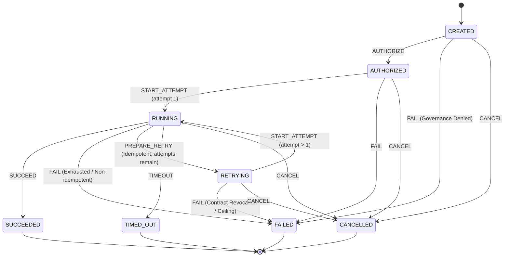
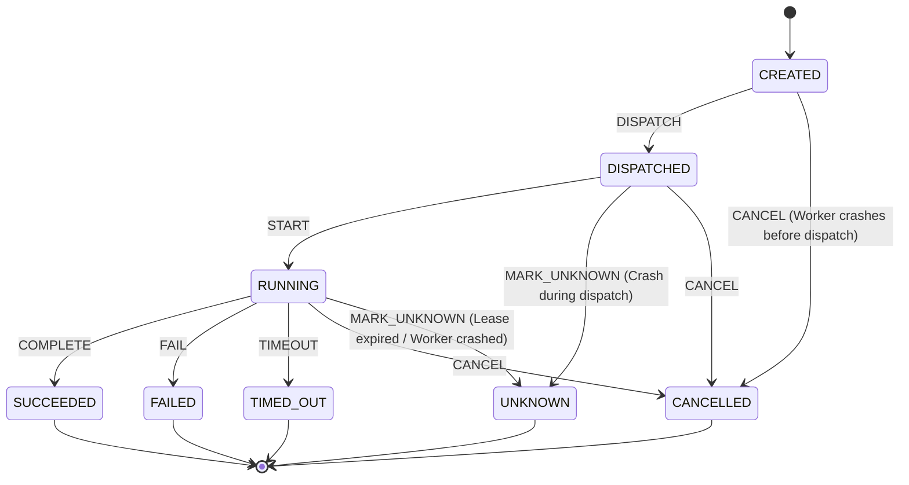

# Phase 31A: Existing Semantics & Architecture Audit

## 1. Executive Summary

Phase 31 focuses on core runtime and persistence guarantees:
1. Deterministic multi-attempt recovery
2. Durable worker lease fencing
3. Crash-safe attempt recovery
4. Stale-worker rejection
5. Deterministic event and evidence continuity

This document establishes the baseline inspection of existing domain aggregates, persistence transaction boundaries, error hierarchies, and recovery workflows prior to code modifications.

- **Baseline SHA**: `70979cf4bcbf4a237b79af3a23449a4b932104d5`
- **Execution Environment**: In-process and local SQLite (WAL mode) persistence.
- **Project Mandate**: ₹0-cost, open-source only, zero model inference, zero external APIs.

---

## 2. Current Invariants

### 2.1 Action Domain Model (`src/domain/action.ts`)
An `Action` represents a single logical unit of intent requested by the execution system.
- **Immutability of Intent**: `actionId`, `runId`, `sequenceNumber`, `toolName`, `inputPayload`, `inputHash`, `idempotency`, `contractBinding`, `maxAttempts`, and `createdAt` are frozen at creation.
- **Status Lifecycle**: `CREATED` $\rightarrow$ `AUTHORIZED` $\rightarrow$ `RUNNING` $\rightarrow$ (`SUCCEEDED` | `FAILED` | `TIMED_OUT` | `CANCELLED` | `RETRYING`).
- **Terminal States**: `SUCCEEDED`, `FAILED`, `TIMED_OUT`, `CANCELLED`.
- **Attempt Accounting**:
  - `activeAttemptNumber`: `number | null`. Must be an integer $\ge 1$ and equal to `totalAttempts` when `RUNNING`; must be `null` in all other states.
  - `totalAttempts`: `number` ($0 \le \text{totalAttempts} \le \text{maxAttempts}$).
  - When in `RETRYING`, $\text{totalAttempts} < \text{maxAttempts}$.
- **Terminal State Invariants**:
  - `completedAt` must be a valid ISO string.
  - `SUCCEEDED`: `errorPayload` must be `null`.
  - `FAILED` / `TIMED_OUT` / `CANCELLED`: `errorPayload` must be non-null.
- **Retry Eligibility Evaluation (`evaluateRetryEligibility`)**:
  - Terminal actions cannot be retried (`TERMINAL_STATE`).
  - Total attempts $\ge$ max attempts cannot be retried (`MAX_ATTEMPTS_EXHAUSTED`).
  - Active attempts running cannot be retried concurrently (`ATTEMPT_STILL_ACTIVE`).
  - Non-idempotent action with `UNKNOWN` attempt cannot be retried (`NON_IDEMPOTENT_UNKNOWN`, fail-closed).
  - Non-idempotent action with `FAILED` attempt cannot be retried (`NON_IDEMPOTENT_FAILED`).
  - Idempotent action with `UNKNOWN` or `FAILED` attempt is eligible for retry if attempts remain.

### 2.2 Attempt Domain Model (`src/domain/attempt.ts`)
An `Attempt` represents one physical trial of an Action.
- **Identity & Scope**: Bound to `attemptId`, `actionId`, `runId`, `attemptNumber`, `workerId`, `leaseId`, and `idempotencyToken` (`${runId}:${actionId}:${attemptNumber}`).
- **Status Lifecycle**: `CREATED` $\rightarrow$ `DISPATCHED` $\rightarrow$ `RUNNING` $\rightarrow$ (`SUCCEEDED` | `FAILED` | `TIMED_OUT` | `CANCELLED` | `UNKNOWN`).
- **Terminal States**: `SUCCEEDED`, `FAILED`, `TIMED_OUT`, `CANCELLED`, `UNKNOWN`.
- **Immutability of Attempt**: All identity fields and initial dispatch timestamps are immutable once created.
- **UNKNOWN Semantics**:
  - Explicit fail-closed state when physical execution outcome cannot be definitively known (e.g. lease expiry, process crash, network partition).
  - Terminal state: cannot be resumed or converted directly into success.
  - Accompanied by typed `reasonCode` (`AttemptUnknownReason`).

### 2.3 Run Domain Model (`src/domain/run.ts`)
- **Status Lifecycle**: `CREATED` $\rightarrow$ `QUEUED` $\rightarrow$ `LEASED` $\rightarrow$ `RUNNING` $\rightarrow$ `RECOVERING` $\rightarrow$ (`QUEUED` | `FAILED` | `COMPLETED` | `TIMED_OUT` | `CANCELLED`).
- **OCC Invariant**: Every state transition increments `version: number`.
- **Worker & Lease Binding**: When `LEASED` or `RUNNING`, `currentWorkerId`, `leaseId`, and `leaseExpiresAt` must be set.

---

## 3. Current State Transition Graphs

### 3.1 Action Transition Graph

### 3.2 Attempt Transition Graph

---

## 4. Current Persistence Transaction Boundaries

The persistence layer (`src/adapters/persistence/sqlite-state-store.ts`) executes all mutative operations inside `BEGIN IMMEDIATE ... COMMIT` blocks via `store.transaction((tx) => ...)`:

1. **Event Sequencing**:
   - `run_events.sequence` is computed inside the transaction:
     `SELECT COALESCE(MAX(sequence), 0) + 1 AS next_seq FROM run_events WHERE run_id = ?`
   - Guarantees strictly monotonic, gapless event numbering per run.
2. **Run Lease Fencing & OCC**:
   - `updateRun` enforces both OCC (`WHERE version = expectedVersion`) and optional fencing (`WHERE lease_id = fencing.leaseId AND current_worker_id = fencing.workerId`).
   - If changes == 0, inspects whether `lease_id` changed (throws `LeaseLostError`) or `version` changed (throws `VersionConflictError`).
3. **Action Operations**:
   - `insertAction`: Enforces monotonic `sequence_number` (`expectedSeq = max_seq + 1`), validates contract binding, and verifies fencing against the run's active lease.
   - `updateAction`: Enforces non-terminal source state, verifies immutability of intent fields, and checks fencing against the run.
4. **Attempt Operations**:
   - `insertAttempt`: Enforces that the parent action is not terminal, that `attemptNumber === max_att + 1` (monotonicity), that no existing attempt is active (`status IN ('CREATED', 'DISPATCHED', 'RUNNING')`), and verifies lease fencing against the run.
   - `updateAttempt`: Enforces that attempt identity fields are immutable, that the attempt is not already in a terminal status, and checks lease fencing against the run.
   - `transitionAttempt`: Pure transition function `applyAttemptTransition` is called, followed by `updateAttempt`.

---

## 5. Existing Gaps Identified

Inspection of `sqlite-state-store.ts`, `lease-manager.ts`, `worker-runtime.ts`, and `run-coordinator.ts` reveals four concrete gaps under Phase 31 requirements:

### Gap 1: Lease Expiration Verification Against Time in Fencing Checks
- **Current Behavior**:
  When `fencing` (`{ workerId, leaseId }`) is checked in `updateAttempt` / `transitionAttempt` / `updateAction`, the SQL query verifies:
  `runRow.current_worker_id === fencing.workerId && runRow.lease_id === fencing.leaseId`.
- **Defect**:
  If Worker A holds Lease A, and Lease A has expired based on wall clock (`nowIso >= lease.expiresAt` or `lease.state !== 'ACTIVE'`), but the sweeper has not yet reassigned the run to Worker B, Worker A's mutation will currently succeed because `runRow.lease_id` still equals `fencing.leaseId`.
- **Required Invariant**: A lease that has passed its expiration timestamp or whose state in the `leases` table is no longer `ACTIVE` must be rejected immediately, preventing late mutations even before sweeper reassignment.

### Gap 2: Lease Renewal Lacks Expiration Guard
- **Current Behavior**:
  In `LeaseManager.renew`, the code checks `if (lease.state !== "ACTIVE") throw ...`.
- **Defect**:
  It does not check whether `nowIso >= lease.expiresAt`. A worker whose lease already expired can invoke `renewLease` and resurrect an expired lease if the sweeper has not updated `lease.state` to `EXPIRED`.
- **Required Invariant**: `LeaseManager.renew` must check `nowIso < lease.expiresAt` and verify that the run's `lease_id` still matches `leaseId`. If expired or stolen, renewal must throw `LeaseLostError` / `LeaseExpiredError`.

### Gap 3: Attempt Ownership Validation
- **Current Behavior**:
  In `updateAttempt` and `transitionAttempt`, fencing validates against the parent `run`.
- **Defect**:
  It does not explicitly cross-check whether the specific `Attempt` being mutated was originally created by that lease (`attempt.leaseId === fencing.leaseId && attempt.workerId === fencing.workerId`).
- **Required Invariant**: A worker holding Lease B on a run cannot mutate Attempt 1 which was created under Lease A.

### Gap 4: Duplicate Completion Idempotency at Worker Seam
- **Current Behavior**:
  If a worker re-delivers a completion message for an attempt that already reached `SUCCEEDED`, `applyAttemptTransition` throws `InvalidAttemptTransitionError` (`Attempt is in terminal state 'SUCCEEDED'`).
- **Defect**:
  Duplicate delivery causes an uncaught error rather than returning the existing authoritative attempt and action snapshot idempotently.
- **Required Invariant**: Duplicate submission of the identical completion for an attempt already in `SUCCEEDED` must be handled idempotently: no duplicate events, no duplicate state transitions, and deterministic return of the existing state.

---

## 6. Existing Tests Review

The repository contains extensive test coverage verifying baseline mechanisms:
- `tests/persistence/concurrency-fencing.test.ts`: Verifies run-level OCC (`VersionConflictError`), run-level request idempotency (`idempotencyKey`), and run-level lease fencing (`LeaseLostError`).
- `tests/persistence/action-attempt-persistence.test.ts`: Verifies action sequence monotonicity, attempt number monotonicity, payload size limits, sensitive key redaction, and run-level lease fencing for actions and attempts.
- `tests/application/worker-runtime-recovery-integration.test.ts`: Verifies crash windows (A through H), UNKNOWN transitions for crashed in-flight attempts, non-idempotent fail-closed retry prevention, idempotent retry bounding, and late zombie result protection.

---

## 7. What Phase 31 Must Change

To achieve full compliance with Invariants A through I:
1. **Domain Errors (`src/domain/errors.ts`)**:
   - Add explicit typed errors if needed (`LeaseExpiredError`, `AttemptNotOwnedError`).
2. **Lease Manager (`src/application/lease-manager.ts`)**:
   - Enforce expiration timestamp checks in `renew`: reject renewal if `nowIso >= lease.expiresAt` or run lease has been superseded.
3. **SQLite Persistence (`src/adapters/persistence/sqlite-state-store.ts`)**:
   - Strengthen `LeaseFencingCheck` in `updateAction`, `transitionAction`, `updateAttempt`, `transitionAttempt`:
     - Verify `current_worker_id === fencing.workerId` and `lease_id === fencing.leaseId`.
     - Verify lease in `leases` table has `state === 'ACTIVE'` and `expires_at > nowIso`.
     - Verify attempt ownership: `attempt.lease_id === fencing.leaseId && attempt.worker_id === fencing.workerId`.
4. **Idempotent Duplicate Completion (`src/application/worker-runtime.ts` / `src/adapters/persistence/sqlite-state-store.ts`)**:
   - Support idempotent return when an attempt is already `SUCCEEDED` with matching outcome and idempotency token.
5. **Deterministic Test Suite (`tests/persistence/phase31-recovery-fencing.test.ts`)**:
   - Implement the full test matrix (T1–T18) covering valid leases, renewals, expiration rejection, stale worker rejection, concurrency barriers, monotonic attempt creation, and gapless event streams.
